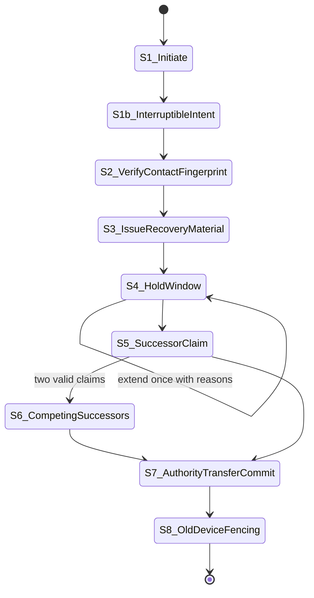

# Recovery ceremony specification v1

Status: **design candidate for independent review; test profile only**. This
document specifies the end-to-end recovery-root replacement ceremony as a
versioned state machine. It is not an implemented feature, does not authorize
integration into any production path, and makes no production security claim.
Existing prototype evidence is cited exactly where it exists; everything else
is unverified specification intent.

Referenced foundation: [`DEVICE-AUTHORITY-DESIGN.md`](DEVICE-AUTHORITY-DESIGN.md)
(independent `R` custody, exact-successor registry/policy chain, local
monotonic pins, strict hold). Ceremony record kinds extend the policy
(`kind 30085`) / registry (`kind 30086`) family; all new record types below are
proposed encoding slots only — none exist in `src/lib` today.

## 1. Existing prototype evidence vs specification-only

Evidence that already exists in isolated modules and tests:

* Independent generation of `R`, `A`, primary `D`
  (`createDeviceAuthoritySetup()`); `replaceDeviceAuthority()` signs a new
  policy epoch from the exact current pinned predecessor and creates fresh `A`
  and primary `D` with a fresh single-device registry.
  Chromium coverage in `scripts/device-authority-browser-test.mjs` executes the
  replacement and peer-side atomic checkpoint reset.
* 24-word BIP-39 phrase export with random word-position confirmation;
  restore validated against an independently supplied recovery public-key pin;
  browser test confirms nothing reaches `localStorage`
  (`src/lib/deviceAuthorityRecovery.js`).
* Optional Argon2id/AES-GCM encrypted recovery package bound to account and
  recovery fingerprint, rejection of tampering/KDF downgrade
  (`src/lib/deviceAuthorityRecoveryPackage.js`).
* Peer-side monotonic pin store: successor must extend the exact stored policy
  id by one recovery-signed epoch; stale/replayed/competing successors
  rejected; cross-tab CAS
  (`src/lib/deviceAuthorityPinStore.js`, `deviceAuthorityPeerStore.js`,
  two-tab Chromium test).
* WebAuthn PRF authority-wrap experiment refusing backup-eligible credentials
  (`src/lib/deviceAuthorityWebAuthn.js`, virtual authenticator).
* Adversarial transport behavior for withheld/stale heads, replay,
  conflicting successors, tampering, wrong recipients
  (`src/lib/deviceAuthorityTransport.js`).

Specification-only below (no implementation evidence):

* The staged ceremony itself, its durable per-phase records, interruption/resume
  rules at every boundary, contact out-of-band fingerprint re-verification as a
  ceremony phase, hold/suspend window semantics, competing-successor
  resolution procedure, post-transfer old-device fencing UX, older-backup
  restore guidance and rollback-detection procedure, and any user-facing copy.
* None of the proposed ceremony records (intent, evidence, claim, commit) have
  builders, serializers, or tests. Nothing here may be wired to app paths.

## 2. Parties and preconditions

| Party | Role | Precondition |
| --- | --- | --- |
| Initiating device | Healthy currently authorized device holding or able to request primary `A` cooperation | Pinned current policy head; authenticated channel to contacts for out-of-band verification |
| Recovery root `R` | Holder of offline 24-word phrase (and optionally sealed package) | Restores against the independently verified recovery fingerprint pin; not derivable from `N` |
| Successor device | New installation claiming authority after transfer | Fresh install; enrolls via successor ceremony, never self-promotes |
| Contact peers | Holders of local monotonic recovery pins | Must independently accept each signed successor extending their own pin |

Preconditions enforced by prior decisions carried forward: no TOFU fallback;
ordinary devices cannot promote themselves; every approval is freshly signed
at the ceremony boundary, never by a cached 30-second lease
(`DEVICE-AUTHORITY-DESIGN.md`, R5-C/D packet).

## 3. Ceremony phases (state machine)

All transitions are versioned; each phase writes named durable records. Every
record carries: schema version, account public key, initiating device id,
ceremony id (fresh random 128-bit), and the exact policy id it extends.
Record names are proposals pending independent encoding review.

### Phase S1 — Initiate (from healthy device)

Entry conditions:

* Initiating device holds a locally pinned current policy head and can reach
  the primary `A` or perform the transition as primary.
* User has explicitly initiated "start recovery preparation" — this phase does
  not disable anything yet.

Actions: the initiating device creates a **CEREMONY-INTENT** record binding
ceremony id, current policy id, intended replacement reason, and creating
timestamp; it publishes evidence of the intent via the same NIP-59 update
transport family so an offline record can be reconstructed on another healthy
device.

Durable records written: `CeremonyIntent` (local, then distributed).

Exit condition: intent persisted AND first distribution attempt recorded.

Interruption rule: crash between persisting the intent and publishing it MUST
leave the system resumable — the local `CeremonyIntent` row carries status
`created-unpublished`; resume re-runs exactly the publish step for that
ceremony id; abort discards the row without touching pins or registry. A
duplicated publish is safe because the exact signed event id is retained and
retried idempotently, matching the existing outbox/CAS contract in
`deviceAuthorityPeerStore.js`. Crash before persist leaves no partial state:
no record, no user-visible change.

### Phase S2 — Verify contact fingerprint out-of-band

Entry: persisted `CeremonyIntent` and at least one reachable contact who holds
an independently established recovery-fingerprint pin (the pin from initial
enrollment, not anything derived from `N`).

Actions: the initiating device presents a QR / safety-number view of the
current recovery fingerprint plus the ceremony-id binding over the existing
account identity; the contact compares it through a previously trusted channel
(the original comparison channel rule from R5-C applies). This phase is also
how a replacement `R` holder authenticates to contacts during actual recovery:
the pin comparison is against the SAME recovery root the contacts already
pinned, which is precisely why continuity requires `R` custody and cannot be
repaired by `N` signatures when `R` was never pinned by the contact.

Durable records: none new beyond updating `CeremonyIntent.status` →
`contact-notified` with per-contact acknowledgement list (`ContactAck`
entries). Contacts durably record their own ack of the out-of-band comparison;
acks are advisory, never an authorization substitute.

Exit: acks recorded OR hold timer decision documented (open gate F-O3).

Interruption rule: crash mid-phase is inherently recoverable — the intent row
already persisted means resume simply continues contacting the remaining
peers; a lost ack entry must be re-obtainable because the comparison is
repeatable by design (same fingerprint, same channel), not consumed. Abort
here still leaves pins and registry untouched.

### Phase S3 — Issue recovery material (what is in `R` custody)

Entry: intent persisted (S2 ack completeness is advisory only).

Actions: `R` custody is exercised exactly as specified in
`DEVICE-AUTHORITY-DESIGN.md`: 24-word phrase presented once, offline,
word-position confirmation required, optional sealed package export, and the
in-memory secret is discarded only after the user completes confirmation
verification. During a live replacement, the restored `R` proves possession by
producing a signature candidate bound to the exact current policy id; the
candidate is NOT yet published.

What is in `R` custody (frozen for this spec): `R` authorizes exactly one
action class — signing a successor policy epoch from the exact pinned
predecessor (new `A`, new primary `D`, fresh single-device registry). It does
NOT restore ratchet/MLS state, does NOT decrypt history, does NOT resurrect
revoked device credentials, and does NOT authorize ordinary enrollment.
Restored sessions start empty except for history already present on the new
installation from normal relays/storage.

Durable records: `CeremonyIntent.status → material-held`; ephemeral signature
candidate lives only in memory until phase S7 exit. If an interrupt crashes
between restoring `R` and completing work, no durable secret-derived artifact
persists other than an already-signed event that is idempotently retriable —
restoring `R` again is always possible because the phrase remains in offline
custody.

Exit: user has completed custody verification (word positions confirmed);
in-memory `R` discarded OR held transiently for the pending phases behind an
explicit UI requirement to confirm again before use.

Interruption: any crash here reduces to "re-enter phrase"; there is no partial
authority mutation anywhere in this phase.

### Phase S4 — Hold / suspend period

Entry: material verified; intent at `material-held`.

Semantics frozen for this spec:

* From S4 entry until the transfer commit exits successfully (S7 exit), BOTH
  the initiating/successor side and adopting peers treat sensitive send
  operations under the existing strict-hold decision (local monotonic pin plus
  strict hold): hold new session creation, prekey publication, ratchet
  authorization and delivery authorization when authority freshness is
  uncertain. Ordinary composition and history reading continue.
* The hold window MAY be extended exactly once with a recorded reason; a
  second extension requires abandoning the ceremony or committing it.
* During the hold window, enrollments, revocations and replacements from the
  OLD authority on the affected account are still validly signed and will be
  accepted by peers pinned to the old head — this window is explicitly NOT a
  revocation freeze. Peers cannot distinguish a legitimately pre-ceremony
  authority action from a compromised-authority action inside this window;
  both reduce to the known stale-peer problem already documented. Aborting the
  ceremony cancels the intent but does not undo any old-authority action taken
  during the window.

Durable records: `CeremonyIntent.status → holding` with hold-start timestamp;
extension writes `HoldExtension{count, reason}`.

Interruption: pure bookkeeping; resume re-reads the intent row. The durable
invariant is: NO phase S1–S4 record ever mutates the policy, registry, or
peer pins. An interrupted ceremony at any point in S1–S4 is therefore defined
as safely abandoned-or-resumable without rollback machinery.

### Phase S5 — Successor claim by new device

Entry: recovery material verified; successor device provisioned (fresh
install).

Actions: the recovered authority signs the successor policy event naming the
exact currently pinned policy as predecessor, incrementing the epoch by one,
creating the new `A` and primary `D`; the successor registry contains only the
primary. The successor device performs possession proof via the standard
enrollment challenge path against the NEW authority. The signed pair is
distributed to contacts via the NIP-59 update transport.

Durable records: `SuccessorClaim{policyEvent, registryEvent}` persisted before
first distribution attempt (retained signed events support idempotent retry,
consistent with the existing commit/retransmit contract); then distributed.

Interruption rule: crash between persisting `SuccessorClaim` and publishing it
MUST leave a defined state: row status `created-unpublished`, resume republishes
the identical signed event id. Crash AFTER publish but BEFORE commit outcome
observation: the publisher re-queries its own pins/local head; if a peer or the
successor's store already applied it, applying the same event again is the
existing idempotent path. Publishing twice is safe; creating a DIFFERENT
successor from the same predecessor is forbidden — concurrent-loser reload
rules from the pin store apply verbatim.

### Phase S6 — Competing-successor resolution

Occurs iff two valid successor policies claim the SAME predecessor policy id.
This is possible only from two parties simultaneously holding valid `R`
custody (e.g., owner and thief, or two backups restored concurrently), since
normal flows serialize on the unique primary performing replacement.

Frozen resolution rules for this spec:

1. Both candidates are valid signatures over distinct event ids extending the
   same predecessor — the policy chain has forked at one hop.
2. Each party resolves using its own local monotonic pin: the first
   successfully committed successor "wins" locally per pin store, since the
   pin refuses to advance twice from one predecessor. There is NO global tie
   breaker available; correctness of global agreement depends on enough
   contacts receiving exactly one of the forks.
3. Detection and reconciliation are USER-MEDIATED and explicit: when a device
   observes a competing successor (a signed policy it did not commit that
   claims its current head), it surfaces a "two recovery roots have acted"
   state and pauses authority-sensitive actions until the human designates
   which branch is correct, verified out-of-band via the fingerprint/custody
   route. Automatic preferring of the higher timestamp, larger registry, or
   gossip-prevalent fork is forbidden: timestamps are signer-controlled
   (precedent: R5 send-time decision).
4. If an attacker forked the chain, the honest remedy is: abandon the
   attacker's branch (do not pin it), re-sign a further successor from the
   attacker branch head ONLY if needed to pull stray adopters back, and record
   the incident. A stolen-then-replaced scenario ends with contacts pinned to
   whichever head they authenticated first; adoption divergence is bounded
   only by contact diligence, matching the already-documented stale-peer limit.

Durable records: `CompetingObservation{otherPolicyId, observedAt}` on each
affected device.

Interruption: observations are additive rows; resolution may be deferred
indefinitely while holds remain in force. No automatic mutation occurs.

### Phase S7 — Authority transfer commit

Entry: `SuccessorClaim` distributed; local devices/primary-side stores ready
to apply.

Actions: successor-primary applies the policy+registry pair atomically to its
own storage (mirroring the existing exact-event CAS/idempotent contract),
begins operating as the new primary, and answers freshness challenges ONLY
under the new epoch. Initiating healthy device updates its pins and becomes an
ordinary enrolled device (unless it is the same physical machine being
restored). Peers apply the replacement per
`applyPeerAuthorityReplacement()`-equivalent semantics: atomic reset of
registry checkpoint history to length 1 under the new policy.

Durable records: successor-side `TransferCommit{policyEventId, registryEventId,
committedAt}`; peer-side pins advance monotonically as today. Failure at any
point before this record exists keeps the predecessor authoritative; the
commit is a single atomic storage transaction per store.

Interruption rule: crash mid-commit relies on the existing transactional
guarantees of the prototypes (IndexedDB transaction; reload revalidates and
accepts the exact winning signed event on retry). The defined states after a
crash are exactly: predecessor still active (nothing applied), OR successor
fully active (all records applied) — no intermediate authority mixing.

### Phase S8 — Old-device fencing post-transfer

Entry: commit observed on the transferred-account side.

Actions:

* Old `A` stops being loaded by the successor-local store (replaced-row
  semantics already in the design: the former primary fails to load it at the
  next recovery-signed epoch).
* Former ordinary devices receive or discover the new policy and fence their
  cached authority state: they refuse their own stale device credentials for
  any operation requiring the new registry, mark themselves displaced, and
  prompt for re-enrollment or removal.
* Peers that were offline throughout S4–S8 keep only the OLD pin and remain in
  strict-hold against this account until they receive and authenticate the
  successor (or later quorum/witness evidence, open dependency). This is
  explicitly restated as an availability cost, not a bug.
* Revoked/exposed devices' plaintext history cannot be erased; fencing is
  forward-looking authorization only.

Durable records: per-old-device `FencedState{seenPolicyId, fencedAt}`;
peer-side pin advancement as usual.

Interruption: fencing is idempotent per old device; a crashed device simply
re-discovers the new policy next time it loads, and any accept-successor
outcome is monotonic. Old devices that never learn of the transfer simply stay
held-out by every new-policy verifier accepting nothing they produce for THIS
account — residual risk: they retain decrypted local data (known limit).

## 4. Restore-from-older-backup semantics

An older backup is a copied whole-browser profile or exported store predating
some newer registry/policy events. Frozen statements:

An older backup CANNOT:

* Resurrect revoked devices' ratchet state: revocation tombstones do not erase
  secrets, but a restored profile holding them produces messages that every
  new-policy verifier rejects because the successor registry excludes those
  devices. Restoring never re-adds devices implicitly; explicit re-enrollment
  through the current authority is required.
* Forge newer registry heads: acceptance always checks the exact predecessor
  and monotonic one-step advance, so an old snapshot cannot fabricate a
  "later" head that outruns events the pin store has not seen — it can only
  LAG. It could replay an old signed event verbatim, which the idempotent
  exact-event retry accepts harmlessly.
* Depin or roll back an honestly advanced local pin by presenting stale
  content alone: pin advancement requires a valid recovery-signed successor
  from the stored policy id; stale content verifies against nothing and is
  refused.

Rollback detection — registry head chain monotonicity:

* Every load revalidates the persisted head/histories as today.
* Monotonic invariant: a device-store load must fail closed if the on-disk
  registry head does NOT extend the highest locally remembered generation/
  policy id within the allowed lag model. Restoring an older whole-profile can
  regress the file; the store treats a regressed-but-valid predecessor as
  LAGGED, exposing a recovery prompt, and MUST NOT silently overwrite either
  direction: merge choices between "lagged old file" and "remembered newer
  head" require explicit user selection gated on re-verifying the recovery
  fingerprint out-of-band. Automatic merging of two diverged histories is
  forbidden in v1 of this spec.
* Recovery after restoring an old backup therefore follows the full S1→S8
  state machine from the CURRENT newest known head the user can authenticate —
  it is never a silent point-in-time resurrection of account state. Sessions
  created in the missing window need re-establishment; plaintext created while
  revoked devices were exposed remains exposed regardless of restore.

Status note: lag/regression handling above is a spec-level rule; today only
plain reload revalidation and monotonic pin advancement exist in code
(`deviceAuthorityStorage.js`, `deviceAuthorityPeerStore.js`). No lag-model
merge logic or user restoration prompt exists.

## 5. Honest threat statement

Stated plainly, as the plan requires: **A recovery root can replace account
authority if it is stolen.** Anyone holding all 24 words — an attacker included
— can sign a valid successor policy, take over which devices are authorized,
and appear indistinguishable from the owner. Without another trust anchor
(e.g., independently verified witnesses, a guardian quorum, or out-of-band
contact re-comparison ceremonies), there is no protection against `R`'s own
theft and no cryptographic way to distinguish holder-from-owner after theft.
Adding such an anchor is a separate approved design step; this ceremony does
not provide it and must not imply otherwise. Correspondingly, if `R` is lost
alongside the primary, safe replacement is impossible in this model and the
fallout is a separately approved identity reset with contact re-verification.

This statement constrains what the ceremony may claim in UX copy (open gate
F-O4): wording MUST say "lets you replace your device authority," not "keeps
your account secure even if your recovery words are stolen."

## 6. What remains OPEN — REVIEWER-OPEN tags

| Tag | Open item | Reason not decided |
| --- | --- | --- |
| F-O1 | Backup availability choice during the recovery window: whether the sealed Argon2id package may be offered as a second route DURING S3/S4 alongside words, and where it resides | **RESOLVED 2026-11-10 (owner): account stays AVAILABLE during recovery/restore - no partial lockout.** Race-window tradeoff accepted and recorded in docs/OWNER-DECISIONS-2026-11-10.md #6; the Argon2id-package-as-second-route sub-question remains open with its usability-study precondition |
| F-O2 | Contact rotation during a pending ceremony: whether contact route keys rotate mid-S4 or freeze until commit | Interaction with the scoped-route rotation gate (Gate B in the gameplan) is unspec'd; freezing has availability costs neither quantified nor reviewed |
| F-O3 | Hold-window length, extension allowance, and whether unacked contacts block progression, including the D-window parameters (hold timeout default, contact ack grace) | Parameters depend on Gate B/Gate C measurement outcomes and the D-window bounded-staleness choice in the R5 decision packet; premature numbers would imply ratified policy |
| F-O4 | UX copy: exact strings for custody warning, competing-root disclosure, fencing notice, and stolen-phrase caveat | **RESOLVED 2026-11-10 (owner): current wording approved.** The user-study pass required by R5-C/D remains a ship precondition; copy changes that follow unresolved F-O2/F-O3 still need re-review |

Reviewer instructions: each tag needs an owner-selected test-profile default
like the D1/D3 precedent, recorded in a follow-up decision document, before
any implementation work item is opened. These tags do not block reviewing the
phase structure and interruption rules themselves.

## 7. Relationship to prior decision records

This spec composes, and defers to, `DEVICE-AUTHORITY-DESIGN.md` (foundation and
limits), `R5-SEND-TIME-REVOCATION-DECISION.md` (timestamps untrusted;
signer-controlled), and `R5-DELIVERY-SEMANTICS-DECISION.md` (send/enqueue/
publish revalidation points). Where this spec names an interruption rule, it
reuses those records' primitives rather than inventing new trust assumptions.
The single remaining global revocation gap — a compromised old `A` serving
stale peers — is inherited unchanged and bounded only by contact adoption of
the successor; multiple relays/timestamps/gossip cannot prove absence of a
withheld newer event.
